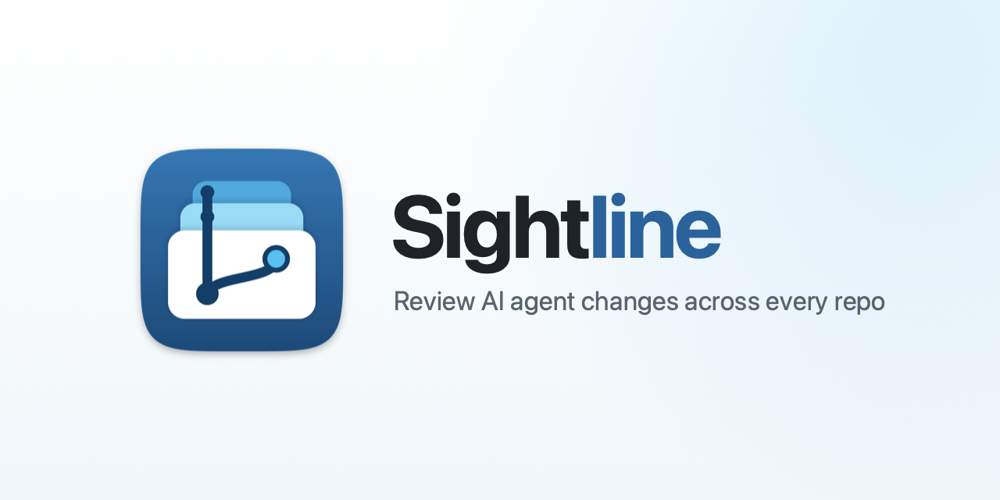

# Sightline



**A clear line of sight into every repo your AI agents touch.**

Sightline is a small, native macOS app for *reviewing* code changes across a workspace made of many git
repos. Point it at a root folder and it finds every nested repo, shows what changed in each one,
lets you read the diffs, stage and commit, jump to any file in any repo, and gives every repo its own
terminal.

It isn't an IDE, and that's on purpose.

## Why I built this

Most of my code is now written by AI agents. My job has shifted from *writing* code to **checking what
the agent did and verifying it**. My workspace is one big root folder with dozens of independent git repos
inside it (services, libraries, apps), and agents happily make changes across many of them at once.

The tools I had didn't fit that workflow:

- **VS Code got slow on the big root.** With a huge multi-repo folder open and agents changing files
  across many repos, VS Code became very laggy and sometimes closed on its own. I didn't need
  extensions, language servers or IntelliSense to *review* changes. I needed something that stays fast.
- **Terminal file explorers stop at one repo.** Tools like Warp have a file explorer, but I couldn't
  search file names across *all* the repos under the root I was working in.
- **GitHub Desktop is one repo at a time, and doesn't speak "AI context".** When you work with an agent
  you constantly hand it precise context: *this file, these lines*. I wanted to copy
  `services/api/src/routes/users.ts:120-148` in one keystroke and paste it straight into the agent.

So Sightline does just those things, quickly.

## What it does

**Made for multi-repo workspaces**
- Scans a root folder and finds every nested git repo (plain nested repos, not only submodules).
- A sidebar with every repo, its branch, ahead/behind counts and number of changed files, all live.
  One click filters it down to **only the repos with changes or unpushed commits**.
- Changes made by an agent or in a terminal show up immediately (FSEvents watcher, no polling, no manual refresh).
- **⌘P: Go to File across every repo**, fuzzy-matched (≈15k files indexed in ~0.2 s via `git ls-files`).
- **⇧⌘F: search inside files**, like VS Code: match case, whole word, regex, files to include/exclude
  (`node_modules` and `dist` excluded by default). Searches the selected repo, or switch to **All repos**
  (~0.5 s across 50 repos). Results are grouped by file with highlighted matches.
- **⌘-click any name** (function, class, variable) to search its repo for it: exact case, whole word, in files
  of the same language (a `.ts` file searches `*.ts, *.tsx, …`). A lightweight "find usages" with no language server.
- **⌥- / ⌥=: go back / forward** through the places you jumped from (search results, ⌘P, the explorer).
- **⌘T: jump to a repo**, sorted by folder, most recently opened, or most opened.

**Made for reviewing AI changes**
- VS Code-style **diff viewer**: side-by-side or inline, whole-file context, syntax highlighting,
  changed-character highlights, aligned filler rows, ↑/↓ to jump between changes, and an
  **overview strip** that shows where in the file the changes are.
- **⇧⌘C copies `path:line` or `path:from-to`** (relative to the workspace root) for the caret or selection,
  in the editor or the diff. Hover a line number for a one-click copy button. Paste it straight into
  Claude Code, Cursor, Codex or any other agent.
- **Mark files as reviewed** (like GitHub's "Viewed"). A mark only holds while the file is unchanged: if the
  agent touches it again, it's back to unreviewed. Marking moves you to the next unreviewed file.
- **Line blame, GitLens style**: the current line shows who last changed it, when, and the commit subject.
  Click it to open that commit.
- **History**: every repo's commits with branch/tag labels and an "unpushed" badge, the full message, the files
  each commit changed, and a whole-file diff per file. This is how you review what the agent already committed.
  **History of one file or folder**: right-click it in the explorer or Changes list, or click the clock icon
  above an open file.
- Stage, unstage and discard per file or per section, then **Commit** or **Commit (No Verify)**. Git hooks
  run with your login-shell `PATH`, so husky/lint-staged find `node`/`npx` even when the app is opened from Finder.
- **Fetch, Pull (fast-forward only) and Push** (publishes new branches), plus branch switching.
- **Open in your editor**: opens the file's repo as the workspace, with the file at the exact line
  (VS Code, Cursor, Windsurf, Zed, Sublime Text, Xcode), or reveal in Finder.

**Just enough to fix things by hand**
- **Tabs** like VS Code, across repos (with an italic preview tab that the next file replaces until you edit or
  double-click it). File explorer with git status colors, new file / new folder (⌘N / ⌥⌘N or right-click), and a plain-text editor with VS Code's everyday keys: find/replace, go to
  line, toggle comment, move/copy/delete lines, indent/outdent, select line, auto-indent, ⌘S.
- **Vim mode** (View → Vim Mode): Normal / Insert / Visual / Visual-line, counts, `d c y > < gu gU` with motions
  (`w b e 0 ^ $ gg G f t ; , % { } n N`) and text objects (`iw aw i" a" i( a{ ip`…), `x X s S r J p P o O ~`,
  `u` / `⌃r`, `.`, `/ ? * #`, `:w :q :wq :x ZZ :<line> :s :%s`, `⌃d ⌃u`, `⌃o ⌃i` (back / forward) and
  `gd` (search the repo for the word). The mode shows in the file header.
- **Markdown preview** (⇧⌘V, or the eye icon): GitHub-styled, with highlighted code blocks and
  **Mermaid diagrams rendered as pictures**. Handy for the plans and design notes agents write; it refreshes when
  the agent edits the file.
- **One terminal per repo**, already `cd`'d into it and kept alive while you switch repos (⌘J to toggle,
  ⌥J to kill and relaunch). GPU (Metal) rendering, 10,000 lines of scrollback, and your Nerd Font is picked up
  automatically so prompt icons render. Terminal colors stay dark by default (View → Terminal Colors).

**Light**
- Native SwiftUI/AppKit, about 4 MB, no Electron, no extensions, no language servers, no indexing of `node_modules`.
- GitHub Light/Dark themed (System, Light or Dark).

## Install

Requires macOS 14 (Sonoma) or later, on Apple Silicon or Intel.

**Download** the latest `Sightline-x.y.z.dmg` from
[Releases](https://github.com/farhancdr/sightline/releases/latest), open it and drag Sightline to Applications.
Every push to `main` that changes the app publishes a new release automatically
([workflow](.github/workflows/release.yml)).

Or build it from source:

```bash
git clone https://github.com/farhancdr/sightline.git
cd sightline
make install     # builds Sightline.app and copies it to /Applications
# or
make dmg         # universal build/Sightline-<version>.dmg with a drag-to-Applications window
```

You need Xcode 26+ (Swift 6.2 toolchain). The package builds in Swift 5 language mode.

Builds aren't notarized yet, so the first time you open a downloaded build, macOS blocks it. Allow it once
via **System Settings → Privacy & Security → Open Anyway**, or run
`xattr -dr com.apple.quarantine /Applications/Sightline.app`. Builds you make locally aren't affected.

## Shortcuts

| Key | Action |
|---|---|
| ⌘P | Go to file (all repos) |
| ⌘N / ⌥⌘N | New file / new folder (in the selected explorer folder; `a/b/c.ts` creates folders too) |
| ⌘T | Find repo (⏎ opens the top match, ⎋ clears) |
| ⇧⌘F | Search in files across all repos (Aa / ab / .* toggles) |
| ⌥- / ⌥= | Go back / forward |
| ⇧⌘C | Copy `path:line` / `path:from-to` for the caret or selection |
| ⌘B | Show / hide the repo sidebar |
| ⇧⌘B | Show / hide the Changes/Files panel |
| ⌘J | Show / hide the terminal |
| ⌥J | Kill the repo's terminal and start a fresh one |
| ⌃` | Focus the terminal |
| ⌘⏎ | Commit |
| ⌘1 / ⌘2 / ⌘3 | Changes / Files / History |
| ⌥⌘V | Toggle "reviewed" for the selected file |
| ⇧⌘E | Open the file's repo in your editor, at the file and caret line |
| ⌘-click | Search the repo for that name (exact case, whole word, same language) |
| ⌥⌘R | Reveal in Finder |
| ⇧⌘L / ⌥⌘P | Pull / Push |
| ⌘S | Save file |
| ⌘W / ⇧⌘W | Close the tab (or diff) / close the window |
| ⌥⌘→ / ⌥⌘← (⌃Tab also goes to the next) | Next / previous tab |
| ⌘F, ⌥⌘F, ⌘G, ⇧⌘G, ⌘E | Find, replace, next, previous, use selection for find |
| ⌃G | Go to line (`120` or `120:5`) |
| ⌘/ | Toggle line comment |
| ⌥↑ / ⌥↓ | Move line(s) up / down |
| ⇧⌥↑ / ⇧⌥↓ | Copy line(s) up / down |
| ⇧⌘K | Delete line(s) |
| ⌘] / ⌘[ (or Tab / ⇧Tab on a selection) | Indent / outdent |
| ⌘L | Select line (repeat to extend) |
| ⇧⌘V | Markdown preview ↔ source |
| ⌘F | Find in file |
| ⇧⌘T | Cycle theme (System → Light → Dark) |
| ⌘O | Open a root folder |
| ⌘R | Refresh all repos |
| ⇧⌘R | Rescan for repos |

## Development

```bash
make run        # debug build and launch (swift run)
make test       # unit tests
make app        # release .app for this Mac's architecture: build/Sightline.app
make universal  # Apple Silicon + Intel .app
make dmg        # universal DMG (scripts/layout-dmg.sh asks Finder to lay out the window;
                # macOS may ask once to allow it)

# Smoke test against a real workspace:
SIGHTLINE_ROOT=~/path/to/your/workspace swift test --filter LiveRootTests

# Next release version (what CI will publish): bump CFBundleShortVersionString in
# Resources/Info.plist to start a new major/minor series, otherwise CI bumps the patch.
scripts/next-version.sh

# Re-render the DMG background and README banner after editing the SVGs in Resources/Design/source:
swift scripts/render-assets.swift
tiffutil -cathidpicheck Resources/dmg-background.png Resources/dmg-background@2x.png -out Resources/dmg-background.tiff
```

```
Sources/Sightline/
  App/            entry point, menu commands, app delegate
  Git/            git process wrapper, status/diff/branch/commit commands, diff model
  Store/          app state, repo scanner, FSEvents watcher, file explorer model, ⌘P index
  Editor/         editor session, line-number gutter, syntax highlighter and language rules
  Terminal/       one SwiftTerm terminal per repo
  Views/          SwiftUI and AppKit views (sidebar, changes, diff, explorer, palette, commit box)
  Support/        GitHub Primer color palette
Resources/        Info.plist, icons, DMG background, welcome illustration, Design/ sources
scripts/          DMG layout and asset rendering
```

### Design notes

- Sightline shells out to your `git` CLI, so hooks, credentials and config behave exactly like in a terminal.
- Status and diff reads run with `GIT_OPTIONAL_LOCKS=0`, so Sightline never writes `.git/index` itself and never
  triggers its own file watcher.
- `git fetch` runs with `ssh -o BatchMode=yes` (unless `GIT_SSH_COMMAND` is set), so a passphrase prompt fails
  fast instead of hanging.
- Syntax highlighting is a small hand-written scanner, not a parser: fast, with no dependencies, and good enough
  for reviewing.

## Third-party

- [SwiftTerm](https://github.com/migueldeicaza/SwiftTerm) (MIT): terminal emulator
- [swift-markdown](https://github.com/swiftlang/swift-markdown) (Apache 2.0): markdown parser
- [Mermaid](https://mermaid.js.org) (MIT): diagrams in the markdown preview, bundled at
  `Resources/Vendor/mermaid.min.js` ([license](Resources/Vendor/MERMAID-LICENSE)); update with
  `scripts/update-mermaid.sh <version>`

## Contributing

Issues and pull requests are welcome. Please run `make test` before opening a PR.

## License

[MIT](LICENSE) © Farhan Sadek
